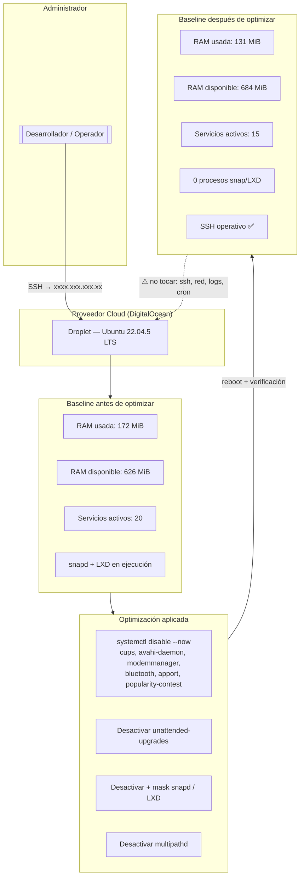

# VPS Optimize — DOCHOADI

Optimización de recursos de un VPS de bajo perfil para maximizar rendimiento
y liberar memoria base (baseline) antes de desplegar cargas de trabajo pesadas
(bases de datos, contenedores, asistentes de IA, herramientas de build, etc.).

---

## 📌 ¿Qué es este proyecto?

Este repositorio documenta un **ejercicio real de hardening y optimización de
rendimiento** sobre un VPS Linux en la nube (DigitalOcean Droplet, 1 GB de RAM).

El problema que resuelve es muy común en entornos cloud:

> Ubuntu por defecto arranca una larga lista de servicios diseñados para
> escritorios físicos y redes domésticas (impresoras, Bluetooth, Snap, telemetría,
> multipath…). En un VPS pequeño eso es **desperdicio puro de RAM**: el sistema
> operativo compite con tu aplicación por una memoria muy limitada y, en el peor
> caso, el kernel **mata procesos (OOM-killer)** o empieza a hacer swap masivo.

El objetivo es **medir el desperdicio → desactivar con seguridad los servicios
que no aportan en un VPS → verificar que el ahorro persiste tras un reinicio**,
dejando una **baseline limpia y reproducible** sobre la que construir.

### Alcance

- ✅ Auditoría inicial del sistema (snapshot `resources-before.txt`)
- ✅ Identificación y desactivación segura de servicios innecesarios
- ✅ Apagado completo del ecosistema **Snap / LXD** (el mayor consumidor)
- ✅ Verificación post-reboot (persistencia + SSH operativo)
- ✅ Documentación final comparativa (`resources-after.txt`)
- ✅ Recomendaciones a corto, medio y largo plazo

---

## 🖥️ Entorno objetivo

| Parámetro | Valor |
|---|---|
| Proveedor | DigitalOcean (Droplet) |
| Host | `bc-vps-457` |
| IP pública | `165.232.68.208` |
| SO | Ubuntu **22.04.5 LTS** (Jammy Jellyfish) |
| Kernel | `5.15.0-191-generic` (x86_64) |
| RAM | 957 MiB (≈ 1 GB) |
| Disco | 25 GB (`/dev/vda1`) |
| Swap | No configurado |

---

## 🧭 Diagrama del proyecto



> **Nota de seguridad:** no se muestran usuarios, credenciales ni IPs reales.

---

## ⚙️ Metodología (paso a paso)

### 1. Fotografía inicial (`resources-before.txt`)

Se capturó el estado del sistema antes de tocar nada:

- Usuario y dirección IP
- Información del kernel y versión del SO
- Uso de RAM (`free -h`)
- Espacio en disco total y libre (`df -h`)
- Listado de servicios en ejecución

**Baseline inicial:**

| Métrica | Valor inicial |
|---|---|
| RAM usada | 172 MiB |
| RAM disponible (`available`) | 626 MiB |
| Servicios activos | 20 |

### 2. Reconocimiento de servicios

Se listaron los servicios habilitados y se consultó el estado de los candidatos
a desactivar, junto con el inventario de paquetes Snap.

**Hallazgos clave:**

- La imagen trae de fábrica un **snap LXD + core22 + snapd** (bloat de proveedor,
  sin uso real en este VPS).
- `snapd`, `multipathd`, `unattended-upgrades` y `apport` estaban activos
  consumiendo RAM.

### 3. Desactivación segura (`systemctl disable --now`)

Se detuvieron y deshabilitaron únicamente servicios de la **lista segura** para
un VPS en la nube:

| Grupo | Servicios |
|---|---|
| Escritorio / hardware | `cups`, `avahi-daemon`, `modemmanager`, `bluetooth` |
| Telemetría / errores | `apport`, `popularity-contest` |
| Actualizaciones automáticas | `unattended-upgrades` (se pasan a `apt` manual) |
| Multipath de almacenamiento | `multipathd.service`, `multipathd.socket` |
| Ecosistema Snap | `snapd.service` + todas sus units + `snap.*` |

> **Seguridad:** NO se tocaron servicios críticos: `ssh`, `systemd-networkd`,
> `systemd-resolved`, `rsyslog`, `systemd-journald` ni `cron`.

### 4. Caso especial: Snap reactivado tras el reboot

Tras el primer reinicio, **`snapd` reapareció** a pesar de estar `disabled`:
el snap `lxd` (activado por `cloud-init`) lo re-triggereaba en el boot.

**Solución aplicada (definitiva):**

```bash
# Desactivar todas las units dependientes
sudo systemctl disable --now snapd.service snapd.socket \
  snapd.seeded.service snapd.apparmor.service snapd.autoimport.service \
  snapd.core-fixup.service snapd.system-shutdown.service \
  snapd.recovery-chooser-trigger.service snap.lxd.activate.service \
  snapd.snap-repair.timer

# Enmascarar para impedir cualquier reactivación
sudo systemctl mask snapd.service snapd.socket
```

Resultado: `snapd` → `inactive` + `masked`, **0 procesos** de snap/lxd en RAM.

### 5. Verificación final

- `free -h` después de los cambios y tras el reboot.
- `systemctl is-active` / `is-enabled` de todos los servicios objetivo.
- Comprobación de que SSH y la red siguen operativos.

---

## 📊 Resultados

### RAM (antes → después)

| Métrica | Antes | Después | Δ |
|---|---|---|---|
| RAM usada | 172 MiB | **131 MiB** | **−41 MiB** |
| RAM disponible (`available`) | 626 MiB | **684 MiB** | **+58 MiB** |

### Servicios en ejecución

| Estado | Antes | Después |
|---|---|---|
| Servicios activos | 20 | **15** (−5 activos, resto deshabilitado o enmascarado) |
| Procesos Snap/LXD | varios | **0** |

### Servicios que permanecen activos (15)

`cron`, `dbus`, `droplet-agent`, `getty@tty1`, `networkd-dispatcher`,
`rsyslog`, `serial-getty@ttyS0`, **`ssh`**, `systemd-journald`,
`systemd-logind`, `systemd-networkd`, `systemd-resolved`,
`systemd-timesyncd`, `systemd-udevd`, `user@0`.

### Garantías

- ✅ **SSH operativo** tras los cambios y tras el `reboot`.
- ✅ Cambios **persistentes** (sobreviven al reinicio).
- ✅ Ningún servicio de red, logging, seguridad o cron fue desactivado.

---

## 🗂️ Estructura del repositorio

```
.
├── README.md               # Este documento (resumen ejecutivo)
├── resources-before.txt    # Snapshot inicial (baseline)
└── resources-after.txt     # Snapshot final + recomendaciones
```

---

## 🧭 Recomendaciones a futuro (resumen)

**Corto plazo**
- Actualizaciones manuales periódicas: `sudo apt update && sudo apt upgrade`
- Añadir **swap** (1–2 GB) para dar colchón de memoria a cargas pesadas
- Si algún día hiciera falta Snap: `sudo systemctl unmask snapd.service snapd.socket`

**Medio plazo**
- Instalar software con `apt`/repos oficiales (evitar Snap)
- Activar firewall (`ufw`) y endurecer SSH (claves, cambio de puerto)
- Monitorización ligera de RAM/disco

**Largo plazo**
- Contenerizar cargas pesadas (Docker con `--memory` limits)
- Evaluar escalar de 1 GB → 2 GB de RAM (baseline ya optimizada)
- Automatizar el aprovisionamiento (Ansible/scripts) para reproducir
  esta configuración en nuevos droplets

---

## 🔧 Comandos clave utilizados

```bash
# Medir memoria
free -h

# Listar servicios en ejecución
systemctl list-units --type=service --state=running

# Desactivar un servicio (parar ahora + no arrancar en boot)
sudo systemctl disable --now <servicio>

# Verificar estado de un servicio
systemctl is-active <servicio>    # → inactive
systemctl is-enabled <servicio>   # → disabled / masked

# Enmascarar (prevenir reactivación)
sudo systemctl mask <servicio>

# Reiniciar y verificar persistencia
sudo reboot
```

---

## ✍️ Autor / Contexto

Ejercicio del curso **AI & Backend** (4Geeks Academy) — módulo de
CLI / operaciones sobre sistemas Linux en la nube.

_Hecho con el objetivo de que un VPS de 1 GB tenga el máximo margen posible
para ejecutar aplicaciones reales sin pelear con el sistema operativo._
